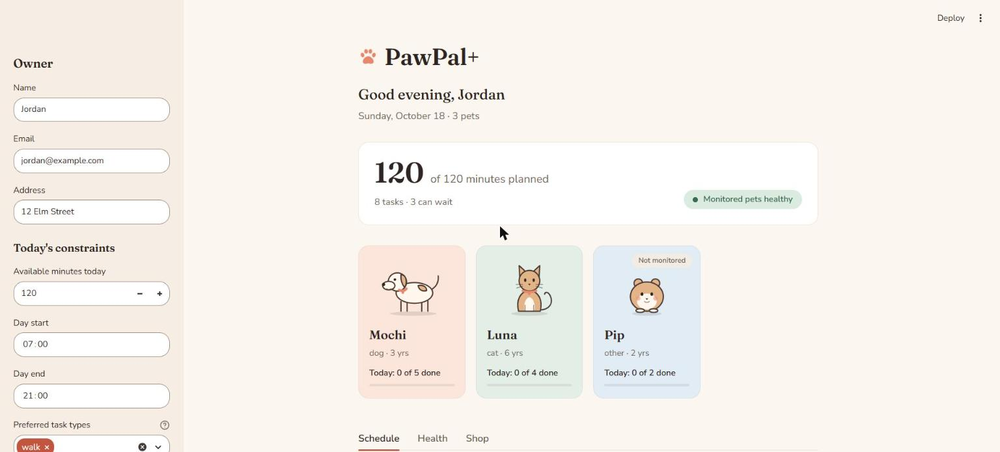
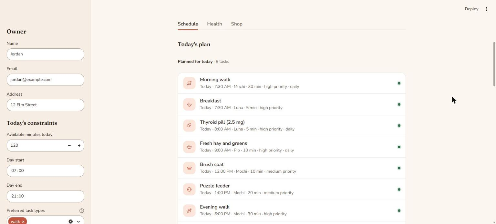
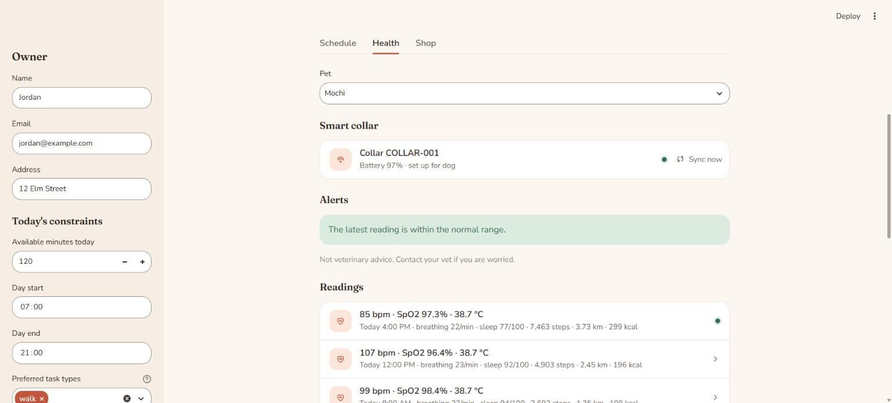
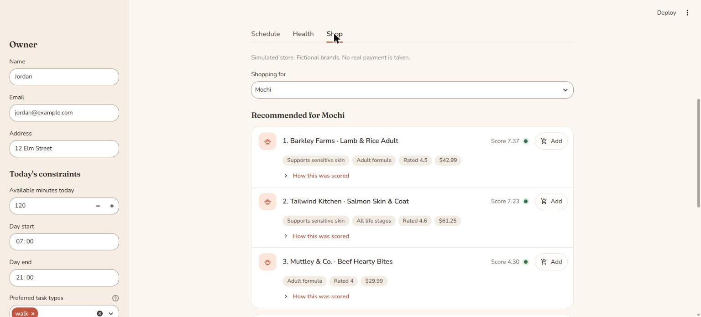

# 🐾 PawPal+

A pet care planner for busy owners. PawPal+ keeps every pet's care tasks in one place,
builds a daily plan that fits the owner's time and waking hours, and explains every
choice in plain English. It also tracks each pet's health with a simulated smart collar
and recommends safe food from a simulated store.

Built for CodePath AI110 (Module 2) with Python, Streamlit, and pytest.

## ✨ Features

**Daily planning**
- Add, edit, remove, and mark tasks done (walks, feeding, medication, enrichment,
  grooming, appointments, deliveries), each with a time, duration, priority, and repeat.
- A daily plan that respects the owner's available minutes and waking hours, ranks by
  priority and preferred task types, and keeps trying smaller tasks after one doesn't fit.
- Medication is always kept, even outside the owner's hours or over budget.
- A plain-English reason for every task planned or left for later.
- Sorting by time or priority, filtering by pet or done status, and conflict warnings.
- Daily and weekly tasks roll over to their next date when marked done.

**🩺 Health Tracker (simulated)**
- A smart collar per pet: heart rate, SpO2, temperature, breathing, sleep, steps,
  distance, and calories, with a daily summary.
- Species-aware alerts for dogs and cats, always shown with a vet disclaimer.
- Medications that add their own reminders to the schedule, plus a symptom log.

**🛒 Food Marketplace (simulated)**
- Recommendations that never include the wrong species or the pet's allergens, ranked
  by health conditions, life stage, rating, and price, with the reason for each.
- Search, compare (including calories), cart, mock checkout (no card details, ever),
  and a delivery task added to the pet's schedule.

**Everything else**
- Save and load all data to `data.json`.
- A warm, accessible UI with animated pet cards (each species has its own hover move;
  reduced-motion is respected), plus formatted CLI output using `tabulate` and emoji.
- 131 automated tests.

## 🚀 Getting started

```bash
python -m venv .venv
.venv\Scripts\Activate.ps1      # Windows PowerShell (macOS/Linux: source .venv/bin/activate)
pip install -r requirements.txt

streamlit run app.py            # the app
python main.py                  # the CLI demo
python -m pytest                # the tests
```

## 🗺️ Design

The full class diagram (20 classes and enums in three groups: core scheduling, health
tracker, and food marketplace) is in [`diagrams/uml.mmd`](diagrams/uml.mmd). Paste it
into [mermaid.live](https://mermaid.live) to view it. It matches `pawpal_system.py`
exactly; every public method in the code is in the diagram.

## 🧩 How PawPal+ works

PawPal+ is built around four classes in `pawpal_system.py`:

- **Owner**: the person. Stores contact details, daily limits (minutes available for pet
  care, waking hours, and preferred task types), and their pets. Pet names must be unique.
- **Pet**: one animal (name, species, breed, age, weight) and its list of care tasks.
  Tasks can be added, edited, or removed, and exact duplicates are refused.
- **Task**: one care item, like a 30-minute walk at 07:30 on a given day. It has a type,
  duration, priority, how often it repeats, and whether it's done.
- **Scheduler**: the "brain." It keeps no tasks of its own. It asks the Owner for every
  pet's tasks through `get_all_tasks()`, keeps the ones due on the chosen day, and sorts
  them by time.

**How data flows:** Owner → Pets → Tasks, and Scheduler → `owner.get_all_tasks()` →
today's schedule. Because the Scheduler always goes through the Owner, it works across
all pets at once, not just one.

The Scheduler uses the owner's daily limits to build a plan: it picks what fits in the
owner's time and hours, ranks by priority and preferences, and explains every task it
planned or skipped (see **📐 Smarter Scheduling**).

## 🖥️ Sample Output
```
Excerpt from `python main.py` (sections 5–7):

```
✅ 5. Today's plan
==================
╭────────┬───────┬───────────────────────┬────────────┬────────────┬────────────╮
│ Time   │ Pet   │ Task                  │ Type       │   Duration │ Priority   │
├────────┼───────┼───────────────────────┼────────────┼────────────┼────────────┤
│ 07:30  │ Mochi │ Morning walk          │ walk       │     30 min │ HIGH       │
│ 07:30  │ Luna  │ Breakfast             │ feeding    │      5 min │ HIGH       │
│ 08:00  │ Luna  │ Thyroid pill (2.5 mg) │ medication │      5 min │ HIGH       │
│ 12:00  │ Mochi │ Brush coat            │ grooming   │     10 min │ MEDIUM     │
│ 18:00  │ Mochi │ Evening walk          │ walk       │     30 min │ HIGH       │
│ 19:30  │ Luna  │ Feather toy play      │ enrichment │     10 min │ LOW        │
╰────────┴───────┴───────────────────────┴────────────┴────────────┴────────────╯
6 tasks, 90 min total
✅ Minutes used: 90 of 90 available

⏳ 6. Skipped tasks (these can wait)
====================================
╭────────┬───────┬───────────────┬────────────┬────────────┬────────────╮
│ Time   │ Pet   │ Task          │ Type       │   Duration │ Priority   │
├────────┼───────┼───────────────┼────────────┼────────────┼────────────┤
│ 13:00  │ Mochi │ Puzzle feeder │ enrichment │     20 min │ MEDIUM     │
│ 16:00  │ Mochi │ Bath          │ grooming   │     40 min │ MEDIUM     │
│ 20:45  │ Luna  │ Nail trim     │ grooming   │     20 min │ LOW        │
╰────────┴───────┴───────────────┴────────────┴────────────┴────────────╯
3 tasks, 80 min total

🐾 7. Why each task was planned or skipped
==========================================
✅ 07:30 Morning walk (Mochi, 30 min): planned. High priority, you prefer walks.
✅ 07:30 Breakfast (Luna, 5 min): planned. High priority.
💊 08:00 Thyroid pill (2.5 mg) (Luna, 5 min): planned. Medication, always kept (health first).
✅ 12:00 Brush coat (Mochi, 10 min): planned. Medium priority.
⏳ 13:00 Puzzle feeder (Mochi, 20 min): skipped. Not enough time left (needs 20 min, 10 min left).
⏳ 16:00 Bath (Mochi, 40 min): skipped. Not enough time left (needs 40 min, 10 min left).
✅ 18:00 Evening walk (Mochi, 30 min): planned. High priority, you prefer walks.
✅ 19:30 Feather toy play (Luna, 10 min): planned. Low priority.
⏳ 20:45 Nail trim (Luna, 20 min): skipped. Would run past your hours (ends 21:05).
```

## 🧪 Testing PawPal+

```bash
python -m pytest        # run the suite
python -m pytest -v     # see each test by name
```

**131 tests, all passing.** The suite covers validation (time format, owner hours and
time budget, duplicate pets and tasks, safe edits that leave the original unchanged),
sorting and filtering across pets, conflict warnings (completed tasks ignored), daily
and weekly recurrence (including month/year rollover and no duplicate copies), and every
daily-planner rule: time budget, priority, preferred types, waking hours, the medication
rule, and skip-then-fit. It also covers the Health Tracker: seeded collar readings,
pairing rules, species-aware alerts, daily summaries, and medication reminders. And the Food Marketplace: allergen and species safety, scoring and explanations that always agree, cart quantities and totals, all-or-nothing checkout, and order status.

**Confidence: ★★★★☆.** Every scheduling, Health Tracker, and Marketplace rule has a test, including
the edge cases right at its boundaries. One star off because the Streamlit UI is tested by hand.

**Known limitations** (by design, and tested as such): conflicts are flagged only for the
exact same date and time; a recurring task's next copy is created only when the current
one is marked complete; overnight hours (e.g. 22:00–06:00) aren't supported.

Sample test output:
```
platform win32 -- Python 3.13.14, pytest-9.1.1, pluggy-1.6.0
collected 131 items

tests\test_pawpal.py ........................................................ [100%]

============================== 131 passed in 0.32s ==============================
```

## 📐 Smarter Scheduling

| Feature | Method(s) | Notes |
|---------|-----------|-------|
| Task sorting | `Scheduler.sort_by_time()`, `Scheduler.sort_by_priority()` | By "HH:MM" time, or by priority (HIGH → LOW), then the owner's preferred task types, then time. Uses a rank table, not the priority text, so MEDIUM correctly comes before LOW. |
| Filtering | `Scheduler.filter_tasks()`, `Scheduler.build_daily_plan()`, `Scheduler.skipped_tasks()` | Filter by pet and/or done status across all pets. The daily plan skips tasks outside the owner's hours or that don't fit the time left, and keeps trying smaller tasks after a skip. |
| Conflict handling | `Scheduler.detect_conflicts()` | Warns (never crashes) when two tasks, for the same pet or different pets, share the same date and time. Exact time matches only; overlapping durations are a planned improvement. |
| Recurring tasks | `Scheduler.mark_task_complete()`, `Task.mark_complete()`, `Task.next_occurrence()` | Completing a daily task creates tomorrow's copy; weekly adds 7 days. If the copy already exists it's reused, never duplicated. |
| Plan explanations | `Scheduler.explain_plan()` | One plain-English line per task saying why it was planned or skipped, including when the medication rule overrode the owner's hours or time budget. |

**Medication rule:** medication is always planned, even outside the owner's hours or over
the time budget, and the explanation says so.

**Priority scheduling example** (`python main.py`, section 2):

```
Time   Pet    Task              Type        Duration  Priority
-----  -----  ----------------  ----------  --------  --------
07:30  Mochi  Morning walk      walk          30 min  HIGH
18:00  Mochi  Evening walk      walk          30 min  HIGH
07:30  Luna   Breakfast         feeding        5 min  HIGH
08:00  Luna   Thyroid pill (2.5 mg)  medication     5 min  HIGH
12:00  Mochi  Brush coat        grooming      10 min  MEDIUM
13:00  Mochi  Puzzle feeder     enrichment    20 min  MEDIUM
16:00  Mochi  Bath              grooming      40 min  MEDIUM
19:30  Luna   Feather toy play  enrichment    10 min  LOW
20:45  Luna   Nail trim         grooming      20 min  LOW
```

**Daily plan explanations** (90 minutes available, walks preferred):

```
- 07:30 Morning walk (Mochi, 30 min): planned. High priority, you prefer walks.
- 07:30 Breakfast (Luna, 5 min): planned. High priority.
- 08:00 Thyroid pill (2.5 mg) (Luna, 5 min): planned. Medication, always kept (health first).
- 12:00 Brush coat (Mochi, 10 min): planned. Medium priority.
- 13:00 Puzzle feeder (Mochi, 20 min): skipped. Not enough time left (needs 20 min, 10 min left).
- 16:00 Bath (Mochi, 40 min): skipped. Not enough time left (needs 40 min, 10 min left).
- 18:00 Evening walk (Mochi, 30 min): planned. High priority, you prefer walks.
- 19:30 Feather toy play (Luna, 10 min): planned. Low priority.
- 20:45 Nail trim (Luna, 20 min): skipped. Would run past your hours (ends 21:05).
```

## 🩺 Health Tracker (simulated)

There's no real device. A `SmartCollar` simulates a wearable collar, so the feature can be
built and tested without hardware.

| Feature | Method(s) | Notes |
|---------|-----------|-------|
| Pair a collar | `Pet.pair_collar()` | One collar per pet. Refuses a collar that's already paired, a pet that already has one, or a species mismatch. |
| Read vitals | `SmartCollar.read_vitals(at)`, `Pet.sync_collar(at)` | Heart rate, SpO2, temperature, breathing, sleep score, steps, distance, calories. Values centre on that species' normal range. Seeded, so a run is repeatable. Battery drops 1% per read. |
| Daily summary | `HealthProfile.daily_summary(day)` | Averages for vitals; steps, distance and calories are running totals, so the day's total is the latest reading, never a sum. |
| Alerts | `HealthProfile.check_alerts(species)` | Checks the latest reading against dog and cat normal ranges. Other species are tracked with no alerts. Always shown with: *"Not veterinary advice. Contact your vet if you are worried."* |
| Medications | `Pet.add_medication()`, `Medication.to_tasks()` | Each dose time becomes a 5-minute HIGH medication task in the schedule, which the planner always keeps. If any dose is a duplicate, nothing is added. |
| Symptoms | `HealthProfile.log_symptom()` | Date, description, and severity (mild / moderate / severe). |

**Design decision:** the collar knows its species. At first it produced dog-range values
for every pet, so every cat would have triggered a heart-rate alarm. (A cat's normal range
is 140–220 bpm, and the dog range tops out at 140.)

## 🛒 Food Marketplace (simulated)

A pretend store with 12 products from **fictional brands**. No real store, and no real
payment: `MockPayment` never asks for or stores card details.

| Feature | Method(s) | Notes |
|---------|-----------|-------|
| Recommendations | `Marketplace.recommend_for(pet, top_n)` | First removes the wrong species and anything containing one of the pet's allergens. Then scores the rest and returns the best. |
| Scoring | `Marketplace.score()` | +3 per health condition the food supports, +2 for a life-stage match (young / adult / senior, or "all"), up to +2 for rating, up to +1 for a lower price. Life stage is scored, not filtered. |
| Explanations | `Marketplace.explain_recommendation()` | One line per factor with its points. The points always add up to the score, because both read the same private list. Excluded products say why ("contains chicken, and Mochi is allergic to it"). |
| Search & compare | `Marketplace.search()`, `Marketplace.compare()` | Search by brand or name for one species. Compare shows price, rating, and calories per cup side by side (calories aren't scored). |
| Cart | `Cart.add_item()`, `remove_item()`, `total()` | Adding the same product again increases its quantity. |
| Checkout | `Cart.checkout(owner, payment, pet_name, today)` | Checks everything first (empty cart, unknown pet, declined payment), so a failed checkout changes nothing. Creates order `ORD-0001`, delivery in 3 days, and adds a delivery task to the pet's schedule. |
| Order tracking | `Order.advance_status()` | placed → shipped → delivered. |

**Design decision:** recommendations are a third scheduling-style algorithm (filter, then
rank, then explain), built in agent mode. See `ai_interactions.md`.

## 💾 Save and load

Click **Save** in the sidebar to write everything to `data.json`; the app loads it on the
next start. It saves the owner's info and limits, pets, tasks (done and pending), health
data (readings, medications, symptoms, collars), the cart, and orders. Uses Python's
built-in `json` only: enums are saved as their text values, dates as ISO strings.

- `data.json` is in `.gitignore`, so personal data never goes to GitHub.
- After a load, order IDs continue (the next order isn't a second ORD-0001), and
  medication reminders aren't duplicated.
- **Known limitation:** a loaded collar's random generator restarts from its seed, so the
  readings after a load repeat the sequence from the start.

## 🎬 Demo walkthrough

1. **Add your pets** in the sidebar. Each one gets its own card; hover a card to see the
   pet move (a dog wags and tilts its head, a cat swishes its tail).
2. **Schedule tab:** add tasks. Today's plan updates right away, showing what fits in
   your time, what can wait, and why. Conflicts show as warnings. Mark a daily task done
   and tomorrow's copy appears.
3. **Health tab:** pair a collar, press **Sync now** to take a reading, and see the daily
   summary and alerts. Add a medication, and its reminders join the schedule.
4. **Shop tab:** see safe food picks for a pet with the reasons for each, compare
   products, add to the cart, and check out. A delivery task lands on the pet's schedule.
5. Click **Save** in the sidebar. Restart the app, and everything is still there.





